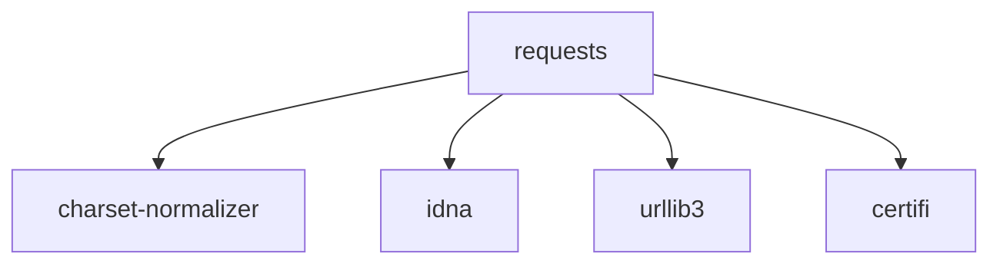
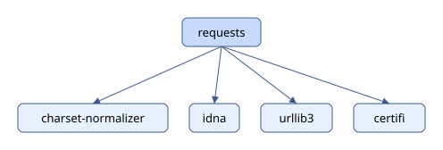
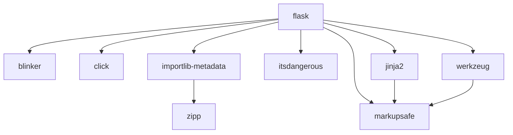
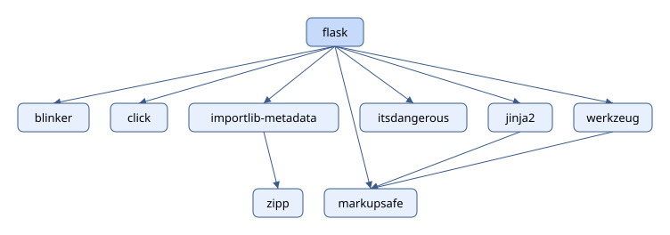
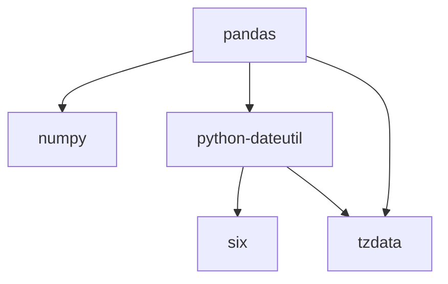
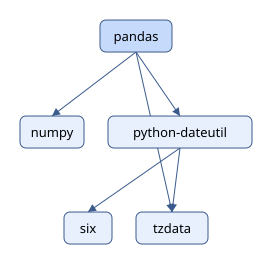
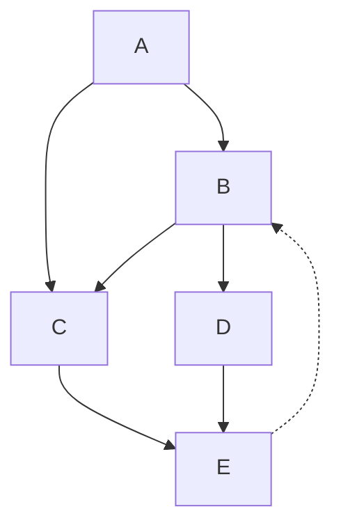
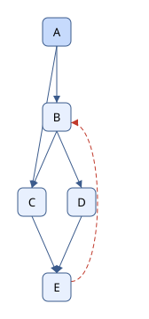

# Визуализатор графа зависимостей pip-пакетов

CLI-приложение на Python для анализа зависимостей пакетов Python (pip).
Готовые менеджеры пакетов и библиотеки для получения зависимостей не
используются, только стандартная библиотека Python.

Текущий этап: **5 — визуализация**. Приложение строит граф
транзитивных зависимостей пакета рекурсивным обходом в глубину (DFS),
пропускает пакеты по подстроке, находит циклы и работает как с PyPI,
так и с тестовым репозиторием из файла. Граф выводится на языке
диаграмм Mermaid, сохраняется в SVG и, если задан параметр,
печатается в виде ASCII-дерева.

| Этап | Ветка | Что добавлено |
|---|---|---|
| 1 | `master` | XML-конфигурация, проверка параметров |
| 2 | `step2` | прямые зависимости из PyPI |
| 3 | `step3` | граф (рекурсивный DFS), фильтр, циклы, тестовый режим |
| 4 | `step4` | порядок загрузки зависимостей, сравнение с pip |
| 5 | `step5` | Mermaid, SVG, ASCII-дерево, сравнение с pip inspect |

## Требования

- Python 3.10+
- Windows (`run.bat`) или любая ОС с прямым вызовом `python src/main.py`

## Структура

```
src/main.py        точка входа CLI
src/config.py      чтение и проверка XML-конфигурации
src/pypi.py        получение прямых зависимостей из PyPI
src/testrepo.py    чтение тестового репозитория
src/graph.py       построение графа (рекурсивный DFS), порядок загрузки
src/visualize.py   Mermaid, ASCII-дерево, SVG
docs/              примеры SVG-изображений
tests/             модульные тесты (unittest)
repos/             тестовые репозитории
scripts/errors/    конфигурации с ошибками для демонстрации
scripts/examples/  конфигурации для пакетов PyPI
scripts/graphs/    конфигурации для тестовых репозиториев
config.xml         пример конфигурации для PyPI
config_test.xml    пример конфигурации для тестового репозитория
run.bat            запуск приложения и тестов
```

## Настройки

Конфигурация задаётся XML-файлом с корневым элементом `<config>`:

```xml
<config>
    <package>requests</package>
    <repository>https://pypi.org/pypi</repository>
    <test_mode>false</test_mode>
    <output_image>graph.svg</output_image>
    <ascii_tree>true</ascii_tree>
    <filter_substring></filter_substring>
</config>
```

| Параметр | Обязателен | Описание |
|---|---|---|
| `package` | да | Имя анализируемого пакета. В тестовом режиме — большие латинские буквы (`A`, `BC`). |
| `repository` | да | URL (`http`/`https`) или путь к тестовому репозиторию (от каталога конфигурации). |
| `test_mode` | да | Режим работы с тестовым репозиторием: `true`/`false` (`yes`/`no`, `1`/`0`). |
| `output_image` | да | Имя файла с изображением графа, расширение `.svg`, каталог должен существовать. |
| `ascii_tree` | нет | Вывод зависимостей в виде ASCII-дерева: `true`/`false`, по умолчанию `false`. |
| `filter_substring` | нет | Пакеты, имя которых содержит эту подстроку, не учитываются. По умолчанию пусто. |

### Обработка ошибок

При ошибке выводится сообщение `Ошибка конфигурации: ...` в stderr, код
завершения `2`. Проверяются:

- файл не существует, некорректный XML, неверный корневой элемент;
- неизвестный, повторяющийся или вложенный параметр;
- отсутствие или пустое значение обязательного параметра;
- недопустимое имя пакета (в обычном и тестовом режиме);
- URL не `http`/`https`, файл тестового репозитория не найден;
- логические параметры не `true`/`false`;
- файл изображения не `.svg` или его каталог не существует.

Примеры для каждого случая лежат в `scripts/errors/`.

Ошибки репозитория (пакет не найден, нет соединения, некорректный JSON,
ошибка в файле тестового репозитория) выводятся как
`Ошибка репозитория: ...`, код завершения `3`. Если корневой пакет
исключён фильтром, выводится `Ошибка анализа: ...`, код `4`. Если не
удалось записать файл изображения — `Ошибка сохранения изображения:
...`, код `5`.

## Получение зависимостей

1. Загружается `<repository>/<package>/json` (последняя версия пакета).
2. Из поля `info.requires_dist` берутся строки формата PEP 508.
3. Зависимости, нужные только для extras (маркер `extra == "..."`),
   отбрасываются — pip не устанавливает их без явного указания extra.
4. Имя приводится к каноническому виду PEP 503 (`Charset_Normalizer` →
   `charset-normalizer`), повторы удаляются.

Маркеры окружения (`python_version < "3.10"` и т.п.) не вычисляются:
такие зависимости показываются всегда, поэтому список может быть шире,
чем то, что pip поставит на конкретной версии Python.

## Построение графа

Граф строится рекурсивным DFS (`GraphBuilder.visit`):

1. Пакет добавляется в текущий путь обхода (стек рекурсии).
2. Запрашиваются его прямые зависимости; пакеты, имя которых содержит
   `filter_substring` (без учёта регистра), отбрасываются и дальше не
   анализируются.
3. Для каждой зависимости: если она уже есть в текущем пути — найден
   цикл, он запоминается, рекурсия не идёт; если пакет уже посещён —
   повторно не обходится; иначе — рекурсивный вызов.

Каждый пакет запрашивается из репозитория ровно один раз, поэтому циклы
не приводят к бесконечной рекурсии. Найденные циклы выводятся отдельно.

### Тестовый репозиторий

При `test_mode=true` параметр `repository` — путь к текстовому файлу,
в котором каждая строка описывает пакет и его зависимости:

```
A: B C
B: D
C: D
D:
```

Имена — большие латинские буквы. Пакет, на который есть ссылка, но нет
своей строки, считается не имеющим зависимостей. Ошибки файла (неверный
формат строки, недопустимое имя, повторное описание пакета, корневой
пакет не описан) сообщаются с номером строки.

Готовые репозитории в `repos/` и конфигурации к ним в `scripts/graphs/`:

| Конфигурация | Что показывает |
|---|---|
| `simple` | ромб A→B,C→D: общий пакет обходится один раз |
| `diamond` | несколько уровней с общими зависимостями |
| `cycle` | цикл A→B→C→A |
| `self_loop` | пакет зависит сам от себя |
| `complex_cycle` | цикл B→C→E→B внутри графа |
| `filter_none` / `filter_b` / `filter_g` | без фильтра и с фильтрами `B`, `G` |
| `filter_root` | корневой пакет исключён фильтром — ошибка |
| `disconnected` | несвязные пакеты Y, Z в граф X не попадают |
| `leaf` | пакет без зависимостей |
| `missing_package` | корневого пакета нет в репозитории — ошибка |
| `bad_name` / `bad_format` / `duplicate` | ошибки в файле репозитория |

## Порядок загрузки зависимостей

Порядок загрузки — топологическая сортировка графа: каждый пакет идёт
после всех своих зависимостей, корневой пакет — последним. Строится
рекурсивным DFS с выводом пакета после обхода его зависимостей
(post-order, `DependencyGraph.load_order`). Каждый пакет выводится один
раз. В графе с циклом строгий порядок невозможен: цикл разрывается на
ребре назад, и выводится предупреждение.

По заданию порядок загрузки выводится только на этапе 4 (ветка
`step4`). На этапе 5 вывод убран, а `load_order` используется для
раскладки узлов на SVG-изображении.

Примеры на тестовом репозитории (этап 4):

| Граф | Порядок |
|---|---|
| `simple`: A→B,C; B→D; C→D | D, B, C, A |
| `diamond`: A→B,C; B→D; C→D,E; D→F; E→F | F, D, B, E, C, A |
| `filter_b` (фильтр `B`) | F, C, A |
| `cycle`: A→B→C→A, C→D | D, C, B, A + предупреждение |
| `complex_cycle`: цикл B→C→E→B | E, C, D, B, A + предупреждение |

### Сравнение с pip

Порядок установки pip виден в строке `Installing collected packages`
(`pip install --target <временный каталог> <пакет>`, Python 3.14,
Windows):

```
requests, наша программа:
  charset-normalizer, idna, urllib3, certifi, requests
requests, pip:
  urllib3, idna, charset_normalizer, certifi, requests

flask, наша программа:
  blinker, click, zipp, importlib-metadata, itsdangerous, markupsafe,
  jinja2, werkzeug, flask
flask, pip:
  markupsafe, itsdangerous, click, blinker, werkzeug, jinja2, flask
```

Расхождения и их причины:

1. **Порядок независимых пакетов разный.** Топологических порядков
   много: пакеты без зависимостей друг от друга (`idna`, `urllib3`,
   `certifi`) можно ставить в любом порядке. Наша программа идёт по
   порядку `Requires-Dist`, а pip использует свой алгоритм с весами
   пакетов, поэтому порядок другой. Главное правило совпадает: в обоих
   случаях `markupsafe` стоит раньше `jinja2` и `werkzeug`, а корневой
   пакет — последним.
2. **Лишние пакеты `importlib-metadata` и `zipp` у flask.** У flask есть
   зависимость `importlib-metadata; python_version < "3.10"`. Наша
   программа не вычисляет маркеры окружения, а pip на Python 3.14 этот
   пакет пропускает.
3. **Выбор версий.** Программа берёт последнюю версию каждого пакета, а
   pip подбирает версии под ограничения (`urllib3<3,>=1.26`). Если
   зависимости у версий разные, состав графа может отличаться.
4. **Циклы.** pip ставит пакеты из цикла вместе, а программа выводит
   предупреждение.

## Визуализация

При каждом запуске программа:

1. выводит текстовое описание графа на языке **Mermaid** (`graph TD`).
   Обычные рёбра обозначаются `-->`, рёбра, замыкающие цикл, — `-.->`;
2. сохраняет изображение графа в **SVG** в файл `output_image`. SVG
   строится без сторонних библиотек: узлы раскладываются по уровням
   (уровень — длина самого длинного пути от корня), корень выделен
   цветом, рёбра цикла нарисованы красной пунктирной дугой;
3. если `ascii_tree=true`, выводит **ASCII-дерево** зависимостей. Общие
   зависимости повторяются в каждой ветке, а
   возврат к пакету из текущей ветки помечается `(cycle)`.

### Примеры для трёх пакетов

**requests** (`scripts/examples/requests.xml`):





**flask** (`scripts/examples/flask.xml`):





**pandas** (`scripts/examples/pandas.xml`):





Тестовый репозиторий с циклом B→C→E→B (`scripts/graphs/complex_cycle.xml`):





Ещё один пример: `docs/test_diamond.svg` (`scripts/graphs/diamond.xml`).

### Сравнение с `pip inspect`

Штатная команда `pip inspect` выгружает JSON с версиями установленных
пакетов, их требованиями `metadata.requires_dist` и параметрами среды
`environment`. Для сравнения трёх примеров из этого раздела установите
пакеты в отдельном окружении и получите отчёт:

```bat
py -m venv .venv
.venv\Scripts\python.exe -m pip install --upgrade pip
.venv\Scripts\python.exe -m pip install requests flask pandas
.venv\Scripts\python.exe -m pip inspect --local > "%TEMP%\pr2-pip-inspect.json"
```

В отчёте найдите корневой пакет в списке `installed`. Для каждой
активной записи `requires_dist` найдите установленную зависимость и
повторите обход. Сверяйте пары «пакет → зависимость» с рёбрами Mermaid
или SVG. Учитывайте маркеры из `environment` и пустой `extra` для установки
без дополнительных возможностей пакета.

Контрольное сравнение на Windows (Python 3.12.14, pip 26.2.2)
сопоставляет отчёт для установленного `pandas 3.0.1` с сохранённой выше
визуализацией приложения:

| Пакет | Активные зависимости по `pip inspect` | Рёбра на SVG |
|---|---|---|
| `pandas` | `numpy`, `python-dateutil`, `tzdata` | `numpy`, `python-dateutil`, `tzdata` |
| `python-dateutil` | `tzdata` (в установленной версии 4.0.0) | `six`, `tzdata` |
| `numpy`, `tzdata` | Нет | Нет |

Ребро к `six` есть на сохранённой диаграмме, а метаданные установленного
`python-dateutil 4.0.0` указывают только `tzdata`. Приложение строит граф
по метаданным последних выпусков каждого пакета на PyPI. Отчёт pip
описывает версии, установленные в конкретном окружении. Возможны
различия из-за маркеров среды: например, приложение показывает ребро
`flask → importlib-metadata` из сохранённого примера, а в Python 3.12
условие `python_version < "3.10"` ложно.

## Функции

`src/config.py`:

- `load_config(path)` — прочитать файл и вернуть объект `Config`;
- `parse_xml(path)` — разобрать XML, проверить корневой элемент;
- `read_values(root)` — собрать значения, проверить обязательные параметры;
- `parse_bool(text, name)` — преобразовать строку в `bool`;
- `check_package(name, test_mode)` — проверить имя пакета;
- `check_repository(value, test_mode, base_dir)` — проверить URL или путь;
- `check_output_image(value, base_dir)` — проверить имя файла изображения;
- `Config.items()` — параметры в виде пар ключ-значение.

`src/pypi.py`:

- `get_dependencies(repository, package)` — прямые зависимости пакета;
- `fetch_metadata(repository, package)` — загрузить JSON-описание;
- `parse_dependencies(metadata)` — список зависимостей из JSON;
- `parse_requirement(line)` — имя пакета из строки Requires-Dist;
- `normalize_name(name)` — каноническое имя (PEP 503);
- `package_url(repository, package)` — URL JSON-описания.

`src/testrepo.py`:

- `load_repository(path)` — прочитать тестовый репозиторий из файла;
- `parse_repository(text)` — разобрать текст в словарь пакет → зависимости;
- `parse_line(line, line_number)` — разобрать строку `A: B C`;
- `check_name(name, line_number)` — проверить имя пакета.

`src/graph.py`:

- `build_graph(root, get_dependencies, filter_substring)` — построить граф;
- `GraphBuilder.build(root)` / `GraphBuilder.visit(name)` — рекурсивный DFS;
- `is_excluded(name, substring)` — проверка фильтра;
- `DependencyGraph.load_order()` / `add_to_order(...)` — порядок загрузки;
- `DependencyGraph.nodes()` / `dependencies(name)` — доступ к графу,
  `cycles` — найденные циклы.

`src/visualize.py`:

- `to_mermaid(graph)` — описание графа на языке Mermaid;
- `ascii_tree(graph)` / `add_branches(...)` — ASCII-дерево;
- `to_svg(graph)` / `save_svg(graph, path)` — SVG-изображение;
- `assign_levels(graph)` / `layout(graph)` — раскладка узлов по уровням;
- `svg_node`, `svg_edge`, `svg_marker`, `node_width` — элементы SVG;
- `back_edges(graph)` — рёбра, замыкающие циклы.

`src/main.py`:

- `parse_args(argv)` — аргументы командной строки;
- `make_source(config)` — источник зависимостей (PyPI или файл);
- `print_cycles(graph)` — вывод найденных циклов;
- `visualize(graph, config)` — Mermaid, SVG и ASCII-дерево;
- `run(config)` — построить граф и вывести его визуализацию;
- `main(argv)` — запуск приложения, возвращает код завершения.

## Сборка и запуск

Сборка не требуется.

```bat
run.bat                     :: запуск с config.xml
run.bat config_test.xml     :: запуск с другой конфигурацией
run.bat test                :: запуск тестов
scripts\test_config.bat     :: демонстрация ошибок конфигурации
scripts\test_deps.bat       :: графы для пакетов PyPI
scripts\test_graphs.bat     :: все случаи тестового репозитория
scripts\test_visual.bat     :: визуализация requests, flask, pandas
```

Без `run.bat`:

```bash
python src/main.py config.xml
python -m unittest discover -s tests -t . -v
```

## Примеры использования

```
> run.bat scripts\examples\requests.xml
Граф зависимостей пакета requests на языке Mermaid:
graph TD
    n0["requests"]
    n1["charset-normalizer"]
    n2["idna"]
    n3["urllib3"]
    n4["certifi"]
    n0 --> n1
    n0 --> n2
    n0 --> n3
    n0 --> n4

Изображение сохранено в C:\...\Pr_2\docs\requests.svg

requests
|-- charset-normalizer
|-- idna
|-- urllib3
`-- certifi

> run.bat scripts\graphs\cycle.xml
Граф зависимостей пакета A на языке Mermaid:
graph TD
    n0["A"]
    n1["B"]
    n2["C"]
    n3["D"]
    n0 --> n1
    n1 --> n2
    n2 -.-> n0
    n2 --> n3

Циклические зависимости:
  A -> B -> C -> A

Изображение сохранено в C:\...\Pr_2\scripts\graphs\cycle.svg

A
`-- B
    `-- C
        |-- A (cycle)
        `-- D

> run.bat scripts\graphs\filter_b.xml        :: filter_substring=B
Граф зависимостей пакета A на языке Mermaid:
graph TD
    n0["A"]
    n1["C"]
    n2["F"]
    n0 --> n1
    n1 --> n2

Изображение сохранено в C:\...\Pr_2\scripts\graphs\filter_b.svg

A
`-- C
    `-- F

> run.bat scripts\graphs\filter_root.xml
Ошибка анализа: пакет A исключён фильтром 'A'

> run.bat scripts\examples\no-such-package-xyz.xml
Ошибка репозитория: пакет 'no-such-package-xyz' не найден

> run.bat scripts\errors\bad_output_image.xml
Ошибка конфигурации: файл изображения должен иметь расширение .svg, получено 'graph.png'
```
